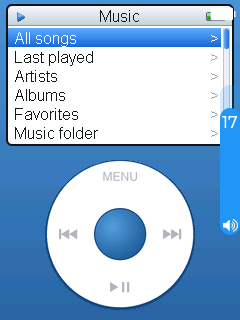
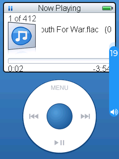

# iPod SL (`v2.2`) for SL6801 MP3 Player

Custom **60 FPS iPod *SL*** firmware for the *Smartlink SL6801* player.

**[Try the Live Interactive WebAssembly Demo & Flasher →](https://fp101fs.github.io/sl6801-ipod/)**

### iPod *SL* Demo (Actual)

https://github.com/user-attachments/assets/bd0a3d29-6547-45a0-a65a-7719ba6d9e52

### Screenshots

| Main Menu (Actual) | Now Playing (Actual) |
| :---: | :---: |
|  |  |

*Captured directly on real SL6801 hardware (`240×320`) via the built-in microSD screenshot/recorder hook.*

Includes reverse-engineering notes, flash tools, touch fixes, and an interactive LVGL 8.3 WebAssembly demo.

---

## What It Does

- **60 FPS UI**: <mark>Replaces all 5 music screens</mark> with an iPod shell.
- **Click Wheel**: Smooth polar touch scrolling with press glows and click audio.
- **Fluid Animations**: Smooth `180 ms` slide transitions and `115 ms` highlight glides.
- **Now Playing**: 3D-tilted album art, glass sheen, and glossy Aqua progress bar.
- **Apple Boot Logo**: Replaces the stock splash with a centered `55×68` logo.
- **Better Touch**: Lowers `CST726` touch threshold for lighter finger taps.
- **Stable FLAC Playback**: Clean audio-device handoff prevents FLAC playback crashes.

## Supported Hardware

- **SoC**: Smartlink **SL6801** dual-core ARM Cortex-M4F.
- **Stock Firmware**: `yp3_2.0.43` (`HLKJ` header, 2 MB Puya SPI NOR flash).
- **Display**: `240×320` RGB565 ST7789S TFT LCD.
- **Touch**: `CST726` capacitive touch on I2C bus 0 (`0x38`).
- **Audio & Storage**: Speaker, 3.5 mm jack, Bluetooth Classic, FM radio, microSD.

## Quick Start

<u>Back up your stock firmware</u> before flashing anything.

### 1. Enter Bootloader Mode (`301a:2800`)
1. Power the player completely **off**.
2. Hold **VOLUME UP** only.
3. Plug in USB-C while still holding **VOLUME UP**.

### 2. Flash or Restore
```bash
# Flash full Blue iPod Classic firmware (recommended)
sudo ./scripts/flash_ipod.sh

# Flash touch sensitivity patch only
sudo ./scripts/flash_sensitive.sh

# Restore untouched stock firmware
sudo ./scripts/flash_restore.sh
```

### 3. Power On After Flashing
1. Unplug the USB-C cable.
2. Hold **Power** for *10 seconds*, then release.
3. Hold **Power** for *3 seconds* to boot.

## Rebuild From Source

```bash
.venv/bin/python ipod/build_ipod.py
```

Uses `ziglang` to compile Cortex-M4F Thumb-2 code into `firmware/sl6801_ipod.bin`.

## Credits

- **USB Flasher**: [`ilyakurdyukov/smartlink_flash`](https://github.com/ilyakurdyukov/smartlink_flash)
- **SL6801 SDK & Tools**: [`dbrant/SL6801_player`](https://github.com/dbrant/SL6801_player)
- **Community Reference**: [`zeroproj/OpenPod`](https://github.com/zeroproj/OpenPod)

---

## LLM Context

<u>Machine-readable summary for AI coding assistants.</u>

### Architecture
- **CPU0**: Runs FreeRTOS, audio decoding, FatFS, Bluetooth, and custom `ClickTask`.
- **CPU1**: Runs the LVGL 8.3 UI loop at 60 FPS.
- **XIP Mapping**: 2 MB SPI NOR flash maps to `0x00C00000 + offset`.
- **Unbrickable ROM**: USB DFU bootloader (`301a:2800`) lives in mask ROM.

### Flash Layout (`yp3_2.0.43`)
- `0x000000` (`0x00C8EC`): Stage-2 `HLKJ` bootloader.
- `0x00D000` (`0x001000`): Partition table (`FIRM`, `TONE`, `PSMP`).
- `0x00E000` (`0x1EA8F0`): `FIRM` partition (FreeRTOS + LVGL 8.3).
- `0x018A8E` (`0x0209E2`, 130 KB): Free flash cave for custom code (`0x00C19000`).
- `0x028000`: Custom `55×68` Apple boot splash (`4.7 KB`).
- `0x1F9000` / `0x1FC000`: `TONE` audio and `PSMP` NV settings.
- **Checksum**: CRC-16/CCITT-FALSE (`poly=0x1021`, `init=0xFFFF`). `v2.2` `FIRM` CRC16 is `0x84A3`.

### Key Patches & Symbols
- **Touch Open (`0x1BD560`)**: Writes `CST726` I2C `0x38` reg `0x80 = 0x10`.
- **Touch Wake (`0x1BD5EC`)**: Re-applies `reg 0x80 = 0x10` on screen wake.
- **Scroll Limit (`0x1ADC94`)**: Raises LVGL `scroll_limit` from `10` px to `20` px.
- **Click Audio Hook**: Hooks `fw_watchdog_setup` (`0x00D4E866`) to launch CPU0 `ClickTask`.
- **FLAC Fix**: Lock-free `CLICK_STOP_MAGIC` to `CLICK_IDLE_MAGIC` closes `/dev/audio0` cleanly.
- **Heap Guards**: `ClickTask` stack trimmed (`0x280` words). `lv_mem_monitor` (`0x00DAF480`) guards CPU1 heap.

### Key Files
- `ipod/ipod_ui.c`: 60 FPS Blue iPod UI, polar wheel, and `ClickTask`.
- `ipod/fw_240x320.h`: Verified LVGL 8.3, ROM math, and OS symbol addresses.
- `ipod/ipod.ld`: Linker script targeting `0x00C19000` (128 KB cave).
- `ipod/gen_assets.py`: Generates Click Wheel, 3D album art, sprites, and PCM audio.
- `ipod/build_ipod.py`: End-to-end Zig build, binary patch, and CRC16 script.
- `firmware/`: Stock backup, touch-only build, and `sl6801_ipod.bin` (`v2.2`).
- `scripts/`: `flash_ipod.sh`, `flash_sensitive.sh`, `flash_restore.sh`, `patch_sensitivity.py`.
- `smartlink_flash/`: macOS-built `smtlink_dump` USB bootloader utility.

### Build & Inspect Commands
- **Rebuild**: `.venv/bin/python ipod/build_ipod.py`
- **Inspect Flash**: `python3 reference/SL6801_player/tools/slfw.py firmware/sl6801_backup.bin info`
- **Dump Flash**: `sudo ./smartlink_flash/smtlink_dump init read_flash 0 2M firmware/sl6801_backup.bin`

### How to vibe-code with SL6801:
- Put SL6801 into bootloader mode:
    - Hold VOLUME UP physical button
    - Then plug in USB C with VOLUME UP held
    - Wait a few seconds
    - Then release the VOLUME UP button
    - *** The screen will NOT display anything at all during the entire "go-into-bootloader-mode" process - absolutely nothing - this is normal.
    - Important:  If you see the splash screen ("welcome"), you are NOT in bootloader mode!  
- Tell your LLM (ex: Claude) to access the SL6801 connected via USB C
- Tell your LLM to change something / add something, and tell the LLM when it's done to give you the CLI command to flash the modified firmware
- Open a new Terminal window and run the command your LLM told you.. a few seconds later (5-10s), the firmware is flashed!
- Unplug USB C cable
- Hold down the power button for 10 seconds (the screen will NOT turn on at this time - this is to take SL6801 out of bootloader mode) and release it fully.
- Then hold down the power button AGAIN for 3 seconds (SL6801 should power up almost instantly when you do this.. you can release power button when you see the welcome/splash screen.
